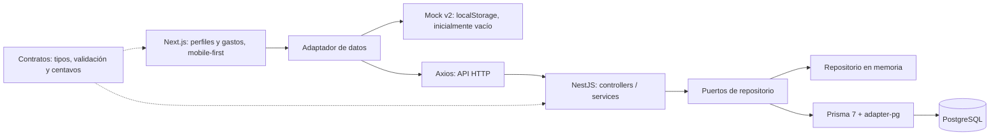
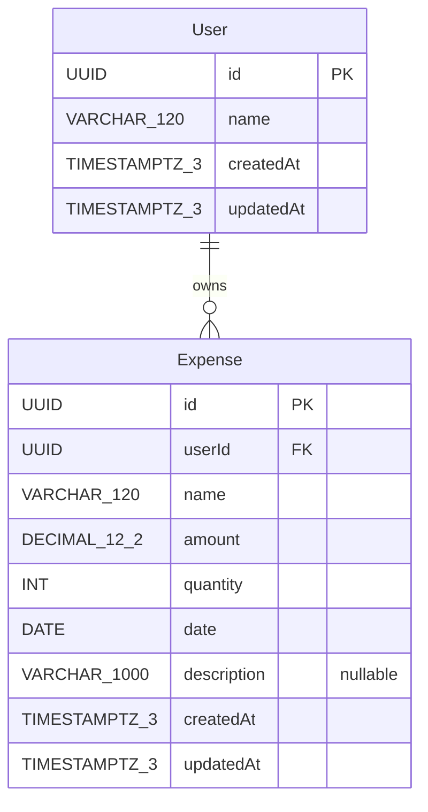

# Arquitectura de Crowanzas — perfiles y gastos

Esta base define perfiles con solo nombre, UUID y timestamps internos. No hay autenticación, sesiones, contraseñas ni correo. La selección de perfil agrupa gastos y **no ofrece aislamiento de seguridad**: quien acceda a la aplicación/API puede consultar otros perfiles y registrar gastos en ellos.

## Capas



Los contratos emiten JS y declaraciones antes del build de aplicaciones. Se mantienen las versiones instaladas: Prisma CLI/client/adapter-pg **7.9.1**, Nest **12.0.3**, Next **16.4.0**, React **19.3.0** y TypeScript **5.9.3**. La URL sigue en `prisma.config.ts`; Prisma usa PostgreSQL y el adaptador correspondiente. Un fallo de base nunca debe activar memoria silenciosamente.

La web selecciona mock/API mediante entorno y conserva el prefijo original de `globals.css`. El diseño busca una experiencia mobile-first, con controles táctiles y listados adaptables. Esta iteración no verificó su comportamiento responsive en navegador.

## Modelo



`User.name` es requerido, recortado y no vacío, hasta 120 caracteres. El nombre **no es único**; el UUID distingue perfiles con el mismo nombre. No hay otros campos de usuario.

Cada gasto requiere un `userId` existente. La relación usa `ON DELETE RESTRICT` y `ON UPDATE CASCADE`. Se conserva el índice global `(date, createdAt)` y se añade `(userId, date, createdAt)`. No se incorporan categorías, edición ni eliminación.

El importe es el costo registrado: total = suma de `amount`, **nunca** `amount * quantity`. Se mantienen cadenas decimales en transporte y centavos `bigint` en helpers. El máximo individual es `9999999999.99`, positivo y con hasta dos decimales; los resúmenes pueden superar ese máximo. La cantidad sigue siendo un entero entre 1 y 1.000.000, el nombre de gasto hasta 120 caracteres y la descripción opcional hasta 1000.

Las fechas son días reales `AAAA-MM-DD`, permitiendo pasado y futuro. La fecha omitida al crear o pedir un resumen diario usa `APP_TIMEZONE`, por defecto `America/La_Paz`. Los listados sin fecha devuelven todo el historial. No se convierte desde UTC el campo date-only; los timestamps de auditoría se transportan como ISO.

## Migración offline y conservación de datos

`20261007000000_initial/migration.sql` se conserva sin cambios. La nueva migración `20261009000000_add_users/migration.sql` está preparada y **no se ejecutó**:

1. En una transacción crea `User`, con nombre requerido y CHECK SQL no vacío, sin unicidad de nombre.
2. Añade `Expense.userId` temporalmente nullable. El bloqueo de tabla mantiene estable la asignación de propietarios.
3. **Solo si hay gastos históricos**, crea `Personal` con UUID determinista `00000000-0000-4000-8000-000000000001` y asigna las filas sin propietario. Conserva todos los demás campos y timestamps de los gastos.
4. Aplica `NOT NULL`, el índice por propietario y la clave foránea Restrict/Cascade, conservando el índice y restricciones anteriores.

Una base nueva sin gastos no recibe `Personal` automáticamente. El esquema anterior no guardaba propietarios, por lo que todos sus registros se agrupan en ese perfil de respaldo. No hay DELETE, TRUNCATE ni reset. Esta migración debe seguir a la inicial; su futura aplicación puede pausar escrituras mientras mantiene el bloqueo. No se conectó ni modificó ninguna base real.

## Contrato HTTP acordado

Prefijo `/api`, web local 3000 y API 3001. CORS explícito `WEB_ORIGIN=http://localhost:3000`. No se fijan URLs de producción.

| Método y ruta | Entrada / filtro | Respuesta |
| --- | --- | --- |
| `GET /api/health` | — | `{status:"ok",storage:"memory"\|"prisma"}` |
| `GET /api/users` | — | `User[]` |
| `POST /api/users` | `CreateUser` | `201 User` |
| `GET /api/users/:userId` | UUID de perfil | `User` |
| `GET /api/users/:userId/expenses` | `date` opcional; omitido = todo el historial del propietario | `Expense[]` |
| `POST /api/users/:userId/expenses` | `CreateExpense`, propietario tomado de la URL | `201 Expense` |
| `GET /api/users/:userId/expenses/summary?date=AAAA-MM-DD` | Omitido = hoy en la zona configurada | `DailySummary` |
| `GET /api/expenses` | `date` opcional; omitido = todo el historial global | `ExpenseWithUser[]` |
| `GET /api/expenses/summary?date=AAAA-MM-DD` | Omitido = hoy en la zona configurada | `UsersDailySummary` |

**El POST global `/api/expenses` queda deshabilitado.** La web crea gastos únicamente mediante el perfil seleccionado. `CreateExpense` no incluye `userId` en el body. Los listados de gastos se ordenan por `createdAt` descendente.

UUID inválido recibe **400**. Propietario desconocido recibe **404**, incluso para listado/resumen vacío. Campos o fechas inválidas conservan errores Nest **400** con `statusCode`, `error` y `message`. `validateCreateUser` devuelve `{name}` recortado o lanza `UserValidationError` con mapa `errors` por campo, siguiendo `ExpenseValidationError`.

```ts
type User = { id: string; name: string; createdAt: string; updatedAt: string };
type CreateUser = { name: string };
type CreateExpense = {
  name: string; amount: string; quantity: number; date?: string; description?: string;
};
type Expense = {
  id: string; userId: string; name: string; amount: string; quantity: number;
  date: string; description: string | null; createdAt: string; updatedAt: string;
};
type ExpenseWithUser = Expense & { user: User };
type DailySummary = {
  userId: string; date: string; total: string; count: number; expenses: Expense[];
};
type UsersDailySummary = {
  date: string; total: string; count: number;
  users: Array<{ user: User; total: string; count: number }>;
};
```

Un perfil existente sin gastos devuelve `DailySummary` con su `userId`, día, `total: "0.00"`, `count: 0` y `expenses: []`. El resumen global **incluye todos los usuarios**, también los de cero gastos. Su count cuenta gastos, no perfiles; total/count suman los grupos. Sin perfiles devuelve `users: []`, `total: "0.00"` y `count: 0`.

## Mock y configuración

Mock **v2 empieza vacío**, ignora los datos v1 y **no elimina la clave antigua de localStorage**. Sus nuevos registros usan el esquema v2; cada gasto exige un usuario conocido. No importa semillas ni crea `Personal` automáticamente. El descarte autorizado afecta solo a mock antiguo, nunca a PostgreSQL.

Seleccionar perfil no crea una sesión. Mock es local al navegador; memoria API se pierde al reiniciar y debe indicarse en UI. La moneda visible por defecto `Bs` es solo presentación, sin contabilidad multimoneda.

Se mantienen `NEXT_PUBLIC_DATA_MODE`, `NEXT_PUBLIC_API_URL`, `NEXT_PUBLIC_APP_TIMEZONE`, `NEXT_PUBLIC_CURRENCY`, `API_STORAGE`, `API_PORT`, `WEB_ORIGIN` y `APP_TIMEZONE`. Una futura base necesita `DATABASE_URL` PostgreSQL en configuración; nunca guardar secretos reales en el repositorio.

## Integración y alcance de validación

Contratos, repositorios memoria/Prisma, controllers/DTOs, adaptadores mock/HTTP y componentes por perfil están implementados. El build raíz del **9 de octubre de 2026** terminó con **exit 0**, compilando contratos primero, regenerando Prisma 7.9.1 y construyendo API/Next. Los tipos emitidos y el cliente generado quedaron actualizados.

La validación autorizada de esta integración fue **solo build**: sin tests, typecheck independiente, auditorías, Playwright, dev servers ni conexiones de base. Las pruebas históricas del MVP no cubren estos cambios. Véase [resultado observado y límites](verification.md).

No se ejecutaron migrate deploy, db push ni aprovisionamiento Neon. Aplicación de migración, comportamiento HTTP/UI y persistencia real siguen sin verificar. La [guía manual de migración futura](../README.md) documenta los comandos sin haberlos ejecutado.
